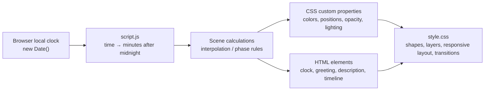

# Daylight — A Living Landscape

## Project overview

Daylight is a responsive, animated lakeside scene that changes with the visitor's real local device time. The assignment demonstrates how a small front-end project can combine semantic HTML, JavaScript time calculations, and CSS drawing/animation without a framework, backend, build system, or external image assets.

The scene moves through a day-night cycle:

**Night → Sunrise / Morning → Day → Golden Hour → Sunset / Dusk → Night**

The design is not a collection of static images. JavaScript calculates time-dependent values and writes them to the page. CSS uses those values to render the scene and transition between visual states.

## Full application flow in short

1. The browser opens `index.html` and loads `style.css`.
2. The HTML creates the scene layers and the text/timeline elements.
3. `script.js` reads the visitor's local time with `new Date()`.
4. It converts the time into minutes after midnight.
5. The scene functions calculate colors, positions, opacity, lighting, text, and the active timeline phase.
6. JavaScript writes some values into the DOM and others into CSS custom properties on `<html>`.
7. CSS uses the updated properties to draw the new state and animate the transition.
8. The update runs immediately, repeats every second, and runs again when a hidden tab becomes visible.

## Project files

| File | Responsibility |
| --- | --- |
| `index.html` | Semantic page structure, decorative scene elements, clock, timeline, and accessible live status |
| `style.css` | Scene artwork, layout, responsive rules, transitions, keyframe animations, and reduced-motion behavior |
| `script.js` | Local-time reading, interpolation, scene updates, clock/text/timeline logic, and visibility handling |
| `readme.md` | Project overview, technical flow, design decisions, and interview preparation |

## Architecture



### Separation of responsibilities

- **HTML is the structure:** it names and groups the visual pieces and provides the meaningful text.
- **JavaScript is the behavior:** it reads local time and decides the current values and text.
- **CSS is the presentation:** it draws the scene and animates CSS property changes.

This separation makes it possible to change the timing logic without rewriting the artwork, or restyle the landscape without changing how time is calculated.

## How the three files work

### 1. `index.html` — document structure

The page has one `<main class="scene">` containing the landscape and the overlays:

1. **Sky:** atmospheric glow, sun, moon, stars, and clouds.
2. **Back and front mountain layers:** their overlap suggests distance.
3. **Lake:** water texture, reflected light, and wave lines.
4. **Foreground:** trees, cabins, and plants.
5. **Golden-hour overlay:** a decorative layer whose opacity is controlled by JavaScript.
6. **Time information:** local-time label, live indicator, `<time>` clock, greeting, and description.
7. **Timeline:** the named day phases and the progress bar.
8. **Live status:** screen-reader text updated by JavaScript.

Most artwork nodes are simple `<div>` and `<span>` elements. They are building blocks for CSS shapes rather than images. Decorative landscape sections use `aria-hidden="true"` so a screen reader does not have to announce every tree, cloud, or wave.

The `<time>` element provides a human-readable time and a machine-readable `datetime` value. The timeline uses `data-phase` attributes; JavaScript reads these to decide which phase receives the `active` class.

`script.js` is included just before `</body>`. That means the page elements exist before the script calls `getElementById()` and `querySelectorAll()`.

### 2. `script.js` — time and behavior

#### Configuration

The `TIME` object stores boundaries in minutes after midnight:

| Name | Value | Meaning |
| --- | ---: | --- |
| `sunrise` | 360 | 6:00 AM |
| `morning` | 540 | 9:00 AM sky color keyframe |
| `noon` | 720 | 12:00 PM sky color keyframe |
| `goldenStart` | 1,020 | 5:00 PM |
| `sunset` | 1,110 | 6:30 PM |
| `dusk` | 1,200 | 8:00 PM |
| `night` | 1,260 | 9:00 PM |

For example, 5:00 PM becomes `17 * 60`, or 1,020. Numeric boundaries make it easy to compare the current time and calculate progress through a period.

`TEST_MODE`, `TEST_HOUR`, and `TEST_MINUTE` provide a fixed-time preview for development. With test mode enabled, `getCurrentTime()` returns the configured time and the live interval is not started.

#### Helper math

- `clamp(value, min, max)` bounds a value, commonly to `0..1`, so opacity and progress stay valid.
- `mapRange(value, inputMin, inputMax, outputMin, outputMax)` converts a value's position in one range to its equivalent position in another.
- `lerp(start, end, progress)` means linear interpolation. At progress `0` it returns the start; at `1` it returns the end.
- `smoothStep(value)` eases a normalized progress value so a transition changes more gently near its endpoints.
- `rgb()` formats numeric color channels as CSS `rgb(...)`.
- `interpolateColor()` smooths the progress and interpolates the red, green, and blue channels separately.

For example, to transition a value from 20 to 80 at 25% progress:

```text
20 + (80 - 20) × 0.25 = 35
```

#### Reading and formatting time

`getCurrentTime()` uses `new Date()` and its local getters (`getHours()`, `getMinutes()`, and `getSeconds()`). The browser therefore uses the visitor's device clock and timezone; there is no server-time or timezone API call.

`getMinutesOfDay()` converts a time to a continuous number:

```text
hours × 60 + minutes + seconds / 60
```

The seconds fraction helps values move smoothly between updates. `formatTime()` creates a 12-hour display such as `5:30 PM`. `updateClock()` writes the display into the page and sets the `<time datetime>` attribute in 24-hour format.

#### Sky interpolation and midnight

`SKY_STOPS` is a set of color keyframes. Each entry defines a time and three RGB arrays: top, middle, and bottom. `getSkyStops()` finds the two neighboring keyframes around the current time. `updateSky()` calculates progress between them and interpolates each of the three colors.

Midnight needs special handling because the day wraps from 23:59 back to 00:00. The code treats the next midnight color as the first stop extended to minute 1,440, adjusts negative elapsed time by a full day, and clamps the result. That keeps the color interpolation range positive and avoids a sudden jump at midnight.

#### Scene update functions

| Function | What it updates |
| --- | --- |
| `updateSun()` | Calculates a left-to-right position and sine-shaped vertical arc; hides it outside the configured daylight interval and scales it during golden hour |
| `updateMoon()` | Makes the moon visible at night and calculates its position over the night interval, including the portion after midnight |
| `updateStars()` | Fades stars in from sunset to night, keeps them visible at night, and fades them toward sunrise |
| `updateNightAtmosphere()` | Sets the opacity of the dark sky overlay |
| `updateClouds()` | Adjusts cloud opacity and brightness toward evening/night |
| `updateGoldenHour()` | Fades a warm overlay in, peaks around the middle of the interval, and eases it down toward sunset |
| `updateReflection()` | Changes the water-reflection opacity for golden hour and night |
| `updateCabinLights()` | Gradually turns cabin lights on at dusk, keeps them on at night, and fades them before sunrise |
| `updateText()` | Selects the greeting and descriptive sentence for the current time range |
| `updateTimeline()` | Sets the active phase class and scales the 24-hour progress indicator |
| `updateAccessibility()` | Refreshes the visually hidden live status text |

Each visual update writes one or more CSS custom properties on `document.documentElement`, which is the `<html>` element. For example:

```js
root.style.setProperty("--sun-x", `${x}%`);
```

CSS reads the same custom property with `var(--sun-x)`. JavaScript calculates the value; CSS decides how that value affects the rendered sun and reflection.

`updateScene()` is the orchestrator. It captures one time snapshot, converts it to minutes, and calls the clock, scene, text, timeline, and accessibility updates so the whole page uses a consistent time.

#### Scheduling

`updateScene()` runs once immediately, before any timer is created. In live mode, `setInterval(updateScene, 1000)` refreshes the scene once per second. Browsers can throttle timers in background tabs, so the `visibilitychange` listener refreshes the scene when the user returns.

### 3. `style.css` — drawing, layout, and motion

#### CSS custom properties

The `:root` rule declares default values for the variables used throughout the scene. The defaults provide an initial appearance; JavaScript updates the time-dependent properties after loading.

Examples:

- `--sky-top`, `--sky-middle`, and `--sky-bottom` color the sky gradient.
- `--sun-x`, `--sun-y`, and `--sun-opacity` position and show the sun.
- `--moon-x`, `--moon-y`, and `--moon-opacity` control the moon.
- `--stars-opacity` and `--night-opacity` control night visibility.
- `--reflection-opacity` and `--cabin-light` control water and cabin lighting.

#### CSS-drawn artwork

- Gradients create the sky, lake, sun, moon, and cabin materials.
- Transparent borders and a colored bottom border create triangular mountains and trees.
- Pseudo-elements (`::before` / `::after`) add water texture, tree trunks, roof highlights, and window glow without adding more HTML nodes.
- Absolutely positioned layers and `z-index` create foreground/background depth.
- `box-shadow`, blur, and opacity create glow and atmospheric effects.

#### Transitions and animations

CSS `transition` rules interpolate changes between successive JavaScript values, such as the sun's position or the sky gradient. `@keyframes` provide continuous decorative movement, such as twinkling, cloud drift, and water motion.

#### Responsive behavior and reduced motion

`clamp()` and viewport units scale selected sizes with the screen. Media queries at 900px, 600px, and 380px adjust landscape proportions, typography, positioning, and the timeline. The mobile timeline can scroll horizontally when its phases do not fit.

The `prefers-reduced-motion: reduce` query minimizes animation and transition duration for visitors who request less motion in their system or browser settings.

## Time-of-day behavior

| Approximate local time | Visible behavior |
| --- | --- |
| Midnight–6:00 AM | Night colors and moon; cabin lights on; stars mostly visible |
| 6:00–9:00 AM | Morning colors; sun rises; darkness and cabin lights fade |
| 9:00 AM–5:00 PM | Day colors and daylight |
| 5:00–6:30 PM | Golden-hour tint and stronger reflection; sun moves toward the horizon |
| 6:30–8:00 PM | Sunset colors; stars begin fading in |
| 8:00–9:00 PM | Dark overlay and cabin lighting gradually increase |
| 9:00 PM onward | Night state |

These are visual rules configured in JavaScript, not astronomical sunrise/sunset calculations. The same clock boundaries apply to every visitor.

## Accessibility notes

- Semantic landmarks and headings communicate the page's information structure.
- Decorative artwork is hidden from assistive technology using `aria-hidden`.
- The `<time>` element includes a machine-readable time value.
- The live status uses `aria-live="polite"` to announce updates without interrupting immediately.
- The reduced-motion media query honors the user's motion preference.

## Assumptions and trade-offs

- The local device time and timezone are reasonably accurate.
- Sunrise, sunset, and phase times are fixed rather than calculated from a geographic location/date.
- CSS shapes keep the project self-contained and avoid image downloads, but the illustration is stylized rather than photorealistic.
- A one-second interval keeps the clock accurate to the displayed second; most scene variables change slowly and CSS transitions smooth the result.
- The page has no dependency installation or build step, which makes it easy to run but means it has no bundling or automated test setup.

## Known implementation details

- The `sunrise` timeline item is present in HTML, but `updateTimeline()` currently marks the `day` item active from sunrise until golden hour. The sunrise entry itself is not selected.
- The timeline's progress bar represents progress through all 24 hours, while the five phase cards are labels rather than equal-duration segments.
- The displayed phase labels are approximate; for example, the sunset card says 6:00 PM while the configured sunset boundary is 6:30 PM.
- The moon's position is calculated, but the lake reflection is positioned with the sun's horizontal CSS variable; the reflection is not a separate moon-positioned reflection.
- Some CSS variables have static defaults and are not currently changed by JavaScript. The runtime-updated variables are the ones referenced by the corresponding update functions.

These details are useful to know when explaining current behavior in an interview or planning future refinements.

## Possible improvements

1. Calculate sunrise/sunset from a user-selected location and date.
2. Add automated browser tests for representative times, including midnight.
3. Allow manual time selection for demos and accessibility testing.
4. Add a distinct sunrise phase to the active timeline logic and align displayed labels with configured boundaries.
5. Add a moon-aligned reflection and tune the scene for lower-powered mobile devices.
6. Add optional ambient sound only with explicit user controls.

## How to run

Open `index.html` in a modern browser. No install or build step is required. A local static development server may also be used.

## Interview-ready introduction

> “I built a responsive landscape that changes throughout the day using vanilla HTML, CSS, and JavaScript. JavaScript reads local device time, converts it to minutes after midnight, and calculates the scene state. It updates text in the DOM and CSS custom properties, while CSS draws the landscape and transitions colors, positions, and lighting. The scene renders immediately, refreshes periodically, handles tab visibility changes, adapts to mobile screens, and respects reduced-motion preferences. Golden hour is the featured state, with a warm overlay and stronger water reflection.”

## Common interview questions

### Why did you use CSS custom properties?

They create a clear boundary between calculations and presentation. JavaScript can update a value such as the sun's x-position without needing to know the detailed CSS used to draw the sun.

### Why convert the time to minutes after midnight?

Numbers are easier to compare and interpolate than formatted strings such as `"5:30 PM"`. Minutes also make progress through a time interval straightforward to calculate.

### How are transitions made smooth?

The JavaScript computes intermediate values with interpolation. CSS transitions animate property changes, while smooth-step easing avoids abrupt acceleration at the ends of some color transitions.

### How does the project know the user's timezone?

It does not request or calculate a timezone separately. `new Date()` and its local getters use the browser/device's local date and time settings.

### Why update both every second and on tab visibility?

The one-second timer keeps the clock current while the page is active. Browsers may throttle background timers, so visibility handling recalculates from the actual current time when the visitor returns.

### How would you test the night or golden-hour designs?

Set `TEST_MODE` to `true` and configure `TEST_HOUR` and `TEST_MINUTE` in `script.js`. For example, 17:30 previews the golden-hour state. Restore `TEST_MODE` to `false` for real local time.

### What would you improve next?

I would add automated browser tests for important boundaries, make the active timeline phases match the exact displayed times, and optionally calculate sunrise/sunset from a chosen location. Those changes would improve verification and make the scene more personalized.
