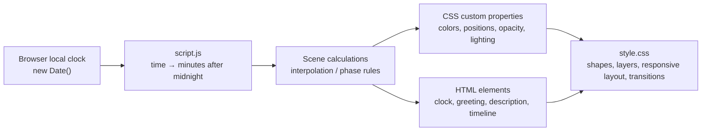

# Daylight - A Living Landscape

## Project overview

Daylight is a responsive, animated lakeside scene that changes with the visitor's real local device time. The assignment demonstrates how a small front-end project can combine semantic HTML, JavaScript time calculations, and CSS drawing/animation without a framework, backend, build system, or external image assets.

The scene moves through a day-night cycle:

**Night → Sunrise / Morning → Day → Golden Hour → Sunset / Dusk → Night**

The design is not a collection of static images. JavaScript calculates time-dependent values and writes them to the page. CSS uses those values to render the scene and transition between visual states.

## Full application flow

1. The browser opens `index.html` and loads `style.css`.
2. The HTML creates the scene layers and the text/timeline elements.
3. `script.js` reads the visitor's local time with `new Date()`.
4. It converts the time into minutes after midnight.
5. The scene functions calculate colors, positions, opacity, lighting, text, and the active timeline phase.
6. JavaScript writes some values into the DOM and others into CSS custom properties on `<html>`.
7. CSS uses the updated properties to draw the new state and animate the transition.
8. The update runs immediately, repeats every second, and runs again when a hidden tab becomes visible.

## Project files

| File | Responsibility |
| --- | --- |
| `index.html` | Semantic page structure, decorative scene elements, clock, timeline, and accessible live status |
| `style.css` | Scene artwork, layout, responsive rules, transitions, keyframe animations, and reduced-motion behavior |
| `script.js` | Local-time reading, interpolation, scene updates, clock/text/timeline logic, and visibility handling |
| `readme.md` | Project overview, technical flow, design decisions, and interview preparation |

## Architecture



### Separation of responsibilities

- **HTML is the structure:** it names and groups the visual pieces and provides the meaningful text.
- **JavaScript is the behavior:** it reads local time and decides the current values and text.
- **CSS is the presentation:** it draws the scene and animates CSS property changes.

This separation makes it possible to change the timing logic without rewriting the artwork, or restyle the landscape without changing how time is calculated.

## How the three files work

### 1. `index.html` — document structure

The page has one `<main class="scene">` containing the landscape and the overlays:

1. **Sky:** atmospheric glow, sun, moon, stars, and clouds.
2. **Back and front mountain layers:** their overlap suggests distance.
3. **Lake:** water texture, reflected light, and wave lines.
4. **Foreground:** trees, cabins, and plants.
5. **Golden-hour overlay:** a decorative layer whose opacity is controlled by JavaScript.
6. **Time information:** local-time label, live indicator, `<time>` clock, greeting, and description.
7. **Timeline:** the named day phases and the progress bar.
8. **Live status:** screen-reader text updated by JavaScript.

Most artwork nodes are simple `<div>` and `<span>` elements. They are building blocks for CSS shapes rather than images. Decorative landscape sections use `aria-hidden="true"` so a screen reader does not have to announce every tree, cloud, or wave.

The `<time>` element provides a human-readable time and a machine-readable `datetime` value. The timeline uses `data-phase` attributes; JavaScript reads these to decide which phase receives the `active` class.

`script.js` is included just before `</body>`. That means the page elements exist before the script calls `getElementById()` and `querySelectorAll()`.

### 2. `script.js` — time and behavior

#### Configuration

The `TIME` object stores boundaries in minutes after midnight:

| Name | Value | Meaning |
| --- | ---: | --- |
| `sunrise` | 360 | 6:00 AM |
| `morning` | 540 | 9:00 AM sky color keyframe |
| `noon` | 720 | 12:00 PM sky color keyframe |
| `goldenStart` | 1,020 | 5:00 PM |
| `sunset` | 1,110 | 6:30 PM |
| `dusk` | 1,200 | 8:00 PM |
| `night` | 1,260 | 9:00 PM |

For example, 5:00 PM becomes `17 * 60`, or 1,020. Numeric boundaries make it easy to compare the current time and calculate progress through a period.

`TEST_MODE`, `TEST_HOUR`, and `TEST_MINUTE` provide a fixed-time preview for development. With test mode enabled, `getCurrentTime()` returns the configured time and the live interval is not started.

#### Helper math

These helper functions are small math tools used to calculate scene values. They help JavaScript move from one visual state to another without abruptly jumping.

##### `mapRange()` — convert a position in one range into another

```js
mapRange(value, inputMin, inputMax, outputMin, outputMax)
```

Think of `inputMin` and `inputMax` as the start and end of the range you have. `outputMin` and `outputMax` are the start and end of the range you want. `value` is the current point in the input range.

For example, golden hour starts at 5:00 PM (1,020 minutes after midnight) and sunset is at 6:30 PM (1,110 minutes). At 5:45 PM, the current value is 1,065:

```js
mapRange(1065, 1020, 1110, 0, 1)
```

This returns `0.5`, meaning the time is halfway between the start and end. Here, `0` represents the beginning of golden hour, and `1` represents its end.

##### `lerp()` — find a value between a start and an end

`lerp` is short for *linear interpolation*:

```js
lerp(start, end, progress)
```

`progress` tells how far to move from `start` to `end`: `0` means start, `1` means end, and `0.5` means halfway. For example:

```js
lerp(20, 80, 0.25) // returns 35
```

The calculation is `20 + (80 - 20) × 0.25 = 35`. The sun uses this kind of calculation to move horizontally from one percentage of the scene to another.

##### `clamp()` — keep a value inside limits

```js
clamp(value, min, max)
```

This keeps a number from going below `min` or above `max`. When the minimum and maximum are `0` and `1`, values smaller than `0` become `0` and values larger than `1` become `1`. This is useful for opacity, where `0` means invisible and `1` means fully visible, and for progress values that should stay within the expected range.

##### `smoothStep()` — make progress ease in and out

A plain progress value moves evenly from `0` to `1`. `smoothStep()` reshapes that value so the change starts gently, moves faster in the middle, and slows near the end. This can make a color change feel less mechanical. It still starts at `0` and ends at `1`.

##### `rgb()` and `interpolateColor()` — blend colors

An RGB color has three numeric channels: red, green, and blue. `rgb()` formats three numbers into a CSS color string, such as `rgb(50, 150, 100)`. `interpolateColor()` calculates the intermediate value for each channel separately.

For example, halfway between `rgb(0, 100, 200)` and `rgb(100, 200, 0)` is approximately `rgb(50, 150, 100)`. The project does this for the top, middle, and bottom colors of the sky.

##### JavaScript interpolation vs. CSS transitions

They work together, but they are different:

1. **JavaScript interpolation** calculates the target value—for example, a new sun position or sky color.
2. JavaScript writes that value to a CSS custom property.
3. **A CSS transition** tells the browser to animate from the previous CSS value to the new one over a specified duration.

So the helper functions calculate *what the next value should be*. CSS transitions control *how the browser visually moves to that value*. In this project, JavaScript refreshes at the start of each minute; CSS transitions can smooth the visual change after each refresh.

#### Reading and formatting time

`getCurrentTime()` uses `new Date()` and its local getters (`getHours()`, `getMinutes()`, and `getSeconds()`). The browser therefore uses the visitor's device clock and timezone; there is no server-time or timezone API call.

`getMinutesOfDay()` converts a time to a continuous number:

```text
hours × 60 + minutes + seconds / 60
```

The seconds fraction represents sub-minute time in calculations. The live scheduler currently updates at minute boundaries, so it samples the time at approximately zero seconds each time. `formatTime()` creates a 12-hour display such as `5:30 PM`. `updateClock()` writes the display into the page and sets the `<time datetime>` attribute in 24-hour format.

#### Sky interpolation and midnight

`SKY_STOPS` is a set of color keyframes. Each entry defines a time and three RGB arrays: top, middle, and bottom. `getSkyStops()` finds the two neighboring keyframes around the current time. `updateSky()` calculates progress between them and interpolates each of the three colors.

Midnight needs special handling because the day wraps from 23:59 back to 00:00. The code treats the next midnight color as the first stop extended to minute 1,440, adjusts negative elapsed time by a full day, and clamps the result. That keeps the color interpolation range positive and avoids a sudden jump at midnight.

#### Scene update functions

| Function | What it updates |
| --- | --- |
| `updateSun()` | Calculates a left-to-right position and sine-shaped vertical arc; hides it outside the configured daylight interval and scales it during golden hour |
| `updateMoon()` | Makes the moon visible at night and calculates its position over the night interval, including the portion after midnight |
| `updateStars()` | Fades stars in from sunset to night, keeps them visible at night, and fades them toward sunrise |
| `updateNightAtmosphere()` | Sets the opacity of the dark sky overlay |
| `updateClouds()` | Adjusts cloud opacity and brightness toward evening/night |
| `updateGoldenHour()` | Fades a warm overlay in, peaks around the middle of the interval, and eases it down toward sunset |
| `updateReflection()` | Changes the water-reflection opacity for golden hour and night |
| `updateCabinLights()` | Gradually turns cabin lights on at dusk, keeps them on at night, and fades them before sunrise |
| `updateText()` | Selects the greeting and descriptive sentence for the current time range |
| `updateTimeline()` | Sets the active phase class and scales the 24-hour progress indicator |
| `updateAccessibility()` | Refreshes the visually hidden live status text |

Each visual update writes one or more CSS custom properties on `document.documentElement`, which is the `<html>` element. For example:

```js
root.style.setProperty("--sun-x", `${x}%`);
```

CSS reads the same custom property with `var(--sun-x)`. JavaScript calculates the value; CSS decides how that value affects the rendered sun and reflection.

`updateScene()` is the orchestrator. It captures one time snapshot, converts it to minutes, and calls the clock, scene, text, timeline, and accessibility updates so the whole page uses a consistent time.

#### Scheduling

`updateScene()` runs once immediately, before any timer is created. In live mode, `scheduleNextMinuteUpdate()` uses `setTimeout()` to schedule the next refresh at the start of the next local minute, then schedules the following one after updating. Aligning to the minute boundary avoids a clock that drifts based on when the page was opened. Browsers can throttle timers in background tabs, so the `visibilitychange` listener refreshes the scene when the user returns.

The visible clock only displays hours and minutes, so per-second updates are unnecessary. A once-per-minute refresh reduces repeated JavaScript work and DOM/CSS writes while keeping the displayed precision accurate. The CSS transitions still smooth the visual change after each refresh.

### 3. `style.css` — drawing, layout, and motion

#### CSS custom properties

The `:root` rule declares default values for the variables used throughout the scene. The defaults provide an initial appearance; JavaScript updates the time-dependent properties after loading.

Examples:

- `--sky-top`, `--sky-middle`, and `--sky-bottom` color the sky gradient.
- `--sun-x`, `--sun-y`, and `--sun-opacity` position and show the sun.
- `--moon-x`, `--moon-y`, and `--moon-opacity` control the moon.
- `--stars-opacity` and `--night-opacity` control night visibility.
- `--reflection-opacity` and `--cabin-light` control water and cabin lighting.

#### CSS-drawn artwork

- Gradients create the sky, lake, sun, moon, and cabin materials.
- Transparent borders and a colored bottom border create triangular mountains and trees.
- Pseudo-elements (`::before` / `::after`) add water texture, tree trunks, roof highlights, and window glow without adding more HTML nodes.
- Absolutely positioned layers and `z-index` create foreground/background depth.
- `box-shadow`, blur, and opacity create glow and atmospheric effects.

#### Transitions and animations

CSS `transition` rules interpolate changes between successive JavaScript values, such as the sun's position or the sky gradient. `@keyframes` provide continuous decorative movement, such as twinkling, cloud drift, and water motion.

#### Responsive behavior and reduced motion

`clamp()` and viewport units scale selected sizes with the screen. Media queries at 900px, 600px, and 380px adjust landscape proportions, typography, positioning, and the timeline. The mobile timeline can scroll horizontally when its phases do not fit.

The `prefers-reduced-motion: reduce` query minimizes animation and transition duration for visitors who request less motion in their system or browser settings.

## Time-of-day behavior

| Approximate local time | Visible behavior |
| --- | --- |
| Midnight–6:00 AM | Night colors and moon; cabin lights on; stars mostly visible |
| 6:00–9:00 AM | Morning colors; sun rises; darkness and cabin lights fade |
| 9:00 AM–5:00 PM | Day colors and daylight |
| 5:00–6:30 PM | Golden-hour tint and stronger reflection; sun moves toward the horizon |
| 6:30–8:00 PM | Sunset colors; stars begin fading in |
| 8:00–9:00 PM | Dark overlay and cabin lighting gradually increase |
| 9:00 PM onward | Night state |

These are visual rules configured in JavaScript, not astronomical sunrise/sunset calculations. The same clock boundaries apply to every visitor.

## Accessibility notes

- Semantic landmarks and headings communicate the page's information structure.
- Decorative artwork is hidden from assistive technology using `aria-hidden`.
- The `<time>` element includes a machine-readable time value.
- The live status uses `aria-live="polite"` to announce updates without interrupting immediately.
- The reduced-motion media query honors the user's motion preference.

## Assumptions and trade-offs

- The local device time and timezone are reasonably accurate.
- Sunrise, sunset, and phase times are fixed rather than calculated from a geographic location/date.
- CSS shapes keep the project self-contained and avoid image downloads, but the illustration is stylized rather than photorealistic.
- A minute-aligned timer keeps the clock accurate to its displayed minute while reducing repeated JavaScript and DOM/CSS updates.
- The page has no dependency installation or build step, which makes it easy to run but means it has no bundling or automated test setup.

## Known implementation details

- The `sunrise` timeline item is present in HTML, but `updateTimeline()` currently marks the `day` item active from sunrise until golden hour. The sunrise entry itself is not selected.
- The timeline's progress bar represents progress through all 24 hours, while the five phase cards are labels rather than equal-duration segments.
- The displayed phase labels are approximate; for example, the sunset card says 6:00 PM while the configured sunset boundary is 6:30 PM.
- The moon's position is calculated, but the lake reflection is positioned with the sun's horizontal CSS variable; the reflection is not a separate moon-positioned reflection.
- Some CSS variables have static defaults and are not currently changed by JavaScript. The runtime-updated variables are the ones referenced by the corresponding update functions.

These details are useful to know when explaining current behavior in an interview or planning future refinements.

## Possible improvements

1. Calculate sunrise/sunset from a user-selected location and date.
2. Add automated browser tests for representative times, including midnight.
3. Allow manual time selection for demos and accessibility testing.
4. Add a distinct sunrise phase to the active timeline logic and align displayed labels with configured boundaries.
5. Add a moon-aligned reflection and tune the scene for lower-powered mobile devices.
6. Add optional ambient sound only with explicit user controls.

## How to run

Open `index.html` in a modern browser. No install or build step is required. A local static development server may also be used.

## Interview-ready introduction

> “I built a responsive landscape that changes throughout the day using vanilla HTML, CSS, and JavaScript. JavaScript reads local device time, converts it to minutes after midnight, and calculates the scene state. It updates text in the DOM and CSS custom properties, while CSS draws the landscape and transitions colors, positions, and lighting. The scene renders immediately, refreshes periodically, handles tab visibility changes, adapts to mobile screens, and respects reduced-motion preferences. Golden hour is the featured state, with a warm overlay and stronger water reflection.”

## Common interview questions

### Why did you use CSS custom properties?

They create a clear boundary between calculations and presentation. JavaScript can update a value such as the sun's x-position without needing to know the detailed CSS used to draw the sun.

### Why convert the time to minutes after midnight?

Numbers are easier to compare and interpolate than formatted strings such as `"5:30 PM"`. Minutes also make progress through a time interval straightforward to calculate.

### How are transitions made smooth?

The JavaScript computes intermediate values with interpolation. CSS transitions animate property changes, while smooth-step easing avoids abrupt acceleration at the ends of some color transitions.

### How does the project know the user's timezone?

It does not request or calculate a timezone separately. `new Date()` and its local getters use the browser/device's local date and time settings.

### Why update on a minute boundary and on tab visibility?

The clock displays hours and minutes, so updating every minute is sufficient and avoids unnecessary per-second work. The timer is aligned to local minute boundaries so it does not drift based on page-load time. Browsers may throttle background timers, so visibility handling recalculates from the actual current time when the visitor returns.

### How would you test the night or golden-hour designs?

Set `TEST_MODE` to `true` and configure `TEST_HOUR` and `TEST_MINUTE` in `script.js`. For example, 17:30 previews the golden-hour state. Restore `TEST_MODE` to `false` for real local time.

### What would you improve next?

I would add automated browser tests for important boundaries, make the active timeline phases match the exact displayed times, and optionally calculate sunrise/sunset from a chosen location. Those changes would improve verification and make the scene more personalized.

### Interview schedule

| Time | Duration | Topic |
| --- | ---: | --- |
| 00:00–00:05 | 5 min | Introductions and project pitch |
| 00:05–00:15 | 10 min | Assignment goals and requirements |
| 00:15–00:30 | 15 min | Architecture and file responsibilities |
| 00:30–00:50 | 20 min | JavaScript time model and helper math |
| 00:50–01:05 | 15 min | CSS rendering, layers, and transitions |
| 01:05–01:15 | 10 min | Live demo and testing strategy |
| 01:15–01:25 | 10 min | Responsive design and accessibility |
| 01:25–01:35 | 10 min | Trade-offs, limitations, and improvements |
| 01:35–01:55 | 20 min | Technical deep dive / small design exercise |
| 01:55–02:00 | 5 min | Candidate questions and closing summary |

### 00:00–00:05 — Introductions and project pitch

**Interviewer: Tell me about the assignment.**

**Example answer:**

> “I built a responsive animated lakeside scene that changes based on the visitor's local device time. I used semantic HTML for the scene structure, vanilla JavaScript to calculate time-dependent values, and CSS to draw the landscape and animate visual changes. It renders immediately, updates at local minute boundaries, refreshes when a hidden tab becomes visible, and includes responsive layouts and reduced-motion support.”

**Interviewer: What was the main challenge?**

**Example answer:**

> “The main challenge was turning a clock time into coordinated visual changes without making the scene switch abruptly. I represented time as minutes after midnight, calculated progress between configured time boundaries, and used that progress for colors, positions, and opacity. CSS custom properties connect those calculations to the presentation.”

**Practice tip:** Keep the opening answer around 30–60 seconds. Start with what the app does, then say how the three technologies work together.

### 00:05–00:15 — Assignment goals and requirements

**Interviewer: What does the page do from a user's point of view?**

**Example answer:**

> “The page shows a stylized landscape and the visitor's local time. As the time changes, the sky palette, sun or moon, stars, clouds, reflections, cabin lighting, greeting, and highlighted timeline phase change. The transitions are intended to feel continuous rather than like switching between separate screens.”

**Interviewer: What are the main time periods?**

**Example answer:**

> “The code defines boundaries such as sunrise at 6 AM, morning at 9 AM, noon at 12 PM, golden hour at 5 PM, sunset at 6:30 PM, dusk at 8 PM, and night at 9 PM. These are fixed design times, not astronomical values calculated for a location.”

**Interviewer: Is the scene a real-time astronomical model?**

**Example answer:**

> “No. It follows the device's local clock, but uses fixed visual boundaries for everyone. A future version could request a location and calculate sunrise and sunset for the date, but that would require a location strategy and careful privacy handling.”

**Interviewer: What is in scope and what is not?**

**Example answer:**

> “It is a static front-end experience. There is no account, backend, API, database, dependency installation, or external image requirement. The artwork is intentionally stylized, and there is no manual time selector in the current interface.”

### 00:15–00:30 — Architecture and file responsibilities

**Interviewer: Walk me through what happens when the page loads.**

**Example answer:**

> “The browser parses `index.html` and loads `style.css`. The HTML elements are declared before `script.js` is loaded at the end of the body, so the script can find them. JavaScript calls `updateScene()` immediately. That reads the current time, calculates the scene state, updates text and CSS custom properties, and the stylesheet renders the result. Live mode then schedules the next minute-boundary update.”

**Interviewer: Why separate HTML, CSS, and JavaScript?**

**Example answer:**

> “Each file has a clear responsibility. HTML defines the elements and meaningful text. JavaScript calculates state and updates the DOM. CSS draws the scene and handles layout and visual transitions. That lets me change the calculation rules without rebuilding the artwork, and restyle the artwork without changing the time model.”

**Interviewer: How does JavaScript communicate with CSS?**

**Example answer:**

> “It updates custom properties on the root `<html>` element with `style.setProperty()`. The stylesheet reads them using `var(--property-name)`. For instance, JavaScript calculates the sun's x-position and writes `--sun-x`; CSS uses that variable for the sun's `left` position and the reflection's location.”

**Interviewer: How are the elements stacked?**

**Example answer:**

> “The scene is a positioned container. The visual layers are absolutely positioned and use `z-index` to establish depth: sky, mountains, lake, foreground, and then the text and timeline. `isolation: isolate` gives the scene its own stacking context, and overflow clipping keeps the artwork inside the viewport.”

**Interviewer: Why load the script at the end of the body?**

**Example answer:**

> “The relevant DOM nodes have already been parsed when the script runs, so calls like `getElementById()` can find them without waiting for a separate DOM-ready event.”

### 00:30–00:50 — JavaScript time model and helper math

**Interviewer: How do you get the visitor's time?**

**Example answer:**

> “`new Date()` reads the browser's current date and time. I use the local getters `getHours()`, `getMinutes()`, and `getSeconds()`, so it follows the device's configured local timezone. The project does not contact a time server.”

**Interviewer: What does minutes since midnight mean?**

**Example answer:**

> “It is a numeric representation of the time: hours times 60, plus minutes, plus the seconds converted to a fraction of a minute. For example, 5:30 PM is 17 hours and 30 minutes, so it is `17 × 60 + 30`, or 1,050 minutes after midnight. A single number makes comparisons and progress calculations easier.”

**Interviewer: Explain `mapRange()` in simple terms.**

**Example answer:**

> “It takes a position in one range and represents the same relative position in another range. The input minimum and maximum are the start and end of the range I have; the output minimum and maximum define the range I want. For golden hour, 1,020 to 1,110 minutes maps to 0 to 1. At 1,065 minutes, the result is 0.5, meaning halfway through.”

**Interviewer: What does `lerp()` do?**

**Example answer:**

> “It finds a value between a start and end using a progress number from 0 to 1. `lerp(20, 80, 0.25)` returns 35, which is one quarter of the way from 20 to 80. The code uses that for positions and visual values.”

**Interviewer: What does `clamp()` protect against?**

**Example answer:**

> “It keeps a number within limits. For example, if opacity must be between 0 and 1, `clamp()` prevents an interpolation calculation from producing an opacity below zero or above one.”

**Interviewer: What is `smoothStep()`?**

**Example answer:**

> “It takes progress from 0 to 1 and reshapes it so a change begins gently, moves faster around the middle, and slows near the end. It is an easing calculation, so the endpoints remain 0 and 1 but the change feels less mechanical.”

**Interviewer: What is a keyframe here?**

**Example answer:**

> “A keyframe is a defined visual state at a particular point. `SKY_STOPS` stores color keyframes: top, middle, and bottom RGB colors at selected times. These are JavaScript data points, not the same thing as CSS `@keyframes`. The code finds the surrounding stops and calculates colors between them.”

**Interviewer: How is a color interpolated?**

**Example answer:**

> “An RGB color is three numeric channels: red, green, and blue. The code calculates a value between the start and end for each channel, then formats those numbers as an `rgb(...)` CSS string. It does this for each sky gradient stop.”

**Interviewer: What is the difference between interpolation and a CSS transition?**

**Example answer:**

> “Interpolation calculates the target value in JavaScript. A CSS transition animates the browser from the old CSS value to that new target. The code computes what the value should be; the transition controls how it looks while changing.”

**Interviewer: Why is midnight a special case?**

**Example answer:**

> “Time wraps from 23:59 to 00:00, but a normal numeric range does not. The sky-stop logic treats midnight as the next day's first color, at minute 1,440, and adjusts elapsed time when it crosses the boundary. That prevents a negative range or an abrupt discontinuity.”

**Interviewer: Why update once per minute instead of every second?**

**Example answer:**

> “The visible clock only shows hours and minutes, so recalculating every second would do unnecessary JavaScript, DOM, and CSS writes. The scheduler aligns the next update to the start of the next minute. The page also renders immediately and refreshes when it becomes visible again, so it can catch up after background timer throttling.”

**Interviewer: Why use a timeout that schedules itself instead of a fixed interval?**

**Example answer:**

> “A one-minute interval would run one minute after the page started, not necessarily at the start of a clock minute. The self-scheduling timeout calculates the milliseconds until the next minute boundary, updates, and schedules again. That keeps the visible minute aligned with the clock.”

**Interviewer: What is the purpose of test mode?**

**Example answer:**

> “It lets me use a fixed hour and minute to inspect a state such as golden hour without changing my computer's clock or waiting for that time. I would turn test mode off before normal use.”

### 00:50–01:05 — CSS rendering, layers, and transitions

**Interviewer: How is the illustration created without images?**

**Example answer:**

> “The scene uses gradients, borders, shadows, pseudo-elements, and positioned HTML elements. For example, transparent left and right borders plus a colored bottom border can make a triangle for a tree or mountain. Rounded elements and gradients create the sun, moon, clouds, and water effects.”

**Interviewer: What is a pseudo-element?**

**Example answer:**

> “`::before` and `::after` let CSS create a decorative generated piece attached to an element without adding another HTML node. They need a `content` declaration. In this project, they add details such as tree trunks, water texture, and window glow.”

**Interviewer: How do the clouds or stars move?**

**Example answer:**

> “CSS `@keyframes` define repeated animation steps, and the `animation` property applies them. Those animations provide ambient motion like twinkling stars and drifting clouds. They are separate from the JavaScript time interpolation: JavaScript controls the scene state, while keyframe animations provide continuous decorative movement.”

**Interviewer: What is the role of `z-index`?**

**Example answer:**

> “It controls the stacking order of positioned layers. The scene uses it to place background elements behind mountains, lake, and foreground, with the interface text and timeline above the illustration.”

**Interviewer: What do `clamp()` and viewport units do in CSS?**

**Example answer:**

> “Viewport units size something relative to the screen. CSS `clamp(min, preferred, max)` lets a size respond to the viewport but stops it becoming too small or too large. That helps typography and artwork scale across devices.”

**Interviewer: How does the golden-hour effect work?**

**Example answer:**

> “The page has a full-scene overlay with a warm gradient. JavaScript changes its opacity during the golden-hour interval. CSS uses a screen blend mode and an opacity transition so the tint is visible without fully covering the landscape.”

**Interviewer: What is the difference between transition and animation?**

**Example answer:**

> “A transition interpolates a property when its value changes, such as a CSS variable changing the sun's position. A keyframe animation can run continuously through declared stages without needing a new JavaScript value each frame.”

### 01:05–01:15 — Live demo and testing strategy

**Interviewer: Demonstrate the project. What will you show?**

**Candidate action plan:**

1. Open `index.html` in a browser.
2. Point out the local clock, greeting, scene, and timeline.
3. Explain that the initial render happens immediately.
4. Temporarily enable test mode and set a time such as 17:30 to show golden hour.
5. If possible, show a night value and explain the stars, moon, overlay, and cabin lights.
6. Restore test mode to `false`.
7. Resize the browser to demonstrate the responsive layout.

**Interviewer: How would you test boundary times?**

**Example answer:**

> “I would test just before, at, and just after each configured boundary—for example, 4:59 PM, 5:00 PM, and 5:01 PM. I would include midnight and sunrise because those cover day-wrap and night-to-morning logic. I would use test mode for these checks.”

**Interviewer: What kinds of tests would you add?**

**Example answer:**

> “I would separate the pure calculations from DOM updates so helper and boundary logic can be unit tested. Then I would add browser tests that set a fixed time and check the clock text, greeting, active timeline phase, and important CSS custom properties. I would also test narrow viewport sizes and the reduced-motion media query.”

**Interviewer: How would you test minute scheduling without waiting a real minute?**

**Example answer:**

> “I would make the scheduling logic testable by injecting or mocking the current date and timers. Then I could check the delay calculation around values such as 12:34:00.000 and 12:34:59.500. In a browser test, fake timers can advance the scheduled callback without waiting in real time.”

**Interviewer: What should the test mode guarantee?**

**Example answer:**

> “It should provide a deterministic time source, disable the live timer, and let the same normal update path render that time. That way the test mode exercises real scene logic rather than a separate mock design.”

### 01:15–01:25 — Responsive design and accessibility

**Interviewer: How does the project adapt to mobile?**

**Example answer:**

> “It uses flexible sizes, viewport units, `clamp()`, and media queries. At smaller breakpoints the scene proportions, typography, cabin, and header adjust. The timeline can scroll horizontally when its phase cards do not fit.”

**Interviewer: Why mark the landscape `aria-hidden`?**

**Example answer:**

> “The trees, clouds, and waves are decorative, not separate information. Hiding those groups avoids a screen reader announcing lots of meaningless shapes. The page still exposes the clock, greeting, description, timeline label, and live status.”

**Interviewer: What does `aria-live="polite"` do?**

**Example answer:**

> “It tells assistive technology that a changed region may be announced when appropriate, without interrupting the user immediately. The hidden status explains the current scene time.”

**Interviewer: Why have a `<time>` element?**

**Example answer:**

> “It semantically identifies the visible content as a time. Its `datetime` attribute can provide a standardized machine-readable representation, while the element's text is the visitor-friendly display.”

**Interviewer: How do you support users who prefer less animation?**

**Example answer:**

> “The stylesheet checks `prefers-reduced-motion: reduce` and makes animation and transition durations nearly instantaneous. That respects a system or browser preference for reduced motion.”

**Interviewer: Is the live announcement every minute always ideal?**

**Example answer:**

> “It avoids announcing every second, but an announcement every minute could still be distracting depending on how the live region is interpreted. I would test with screen readers and consider announcing only meaningful phase changes or making the clock itself the primary accessible time.”

### 01:25–01:35 — Trade-offs, limitations, and improvements

**Interviewer: What trade-offs did you make?**

**Example answer:**

> “Using only CSS shapes keeps the project self-contained and avoids asset loading, but limits detail and realism. Fixed time boundaries keep the logic simple, but they do not reflect actual sunrise and sunset for a person's location. A static project is easy to run, but has no automated test suite or build pipeline.”

**Interviewer: What is a known mismatch in the current project?**

**Example answer:**

> “The sunrise phase is shown in the timeline, but the JavaScript selects the day phase from sunrise until golden hour. Also, the timeline's sunset label says 6:00 PM while the configured sunset boundary is 6:30 PM. I would align the displayed labels and active-state rules.”

**Interviewer: What would you improve first?**

**Example answer:**

> “I would first add boundary-focused automated tests and align the timeline labels with the code's actual time boundaries. Then I would decide whether the product should stay a stylized fixed-time scene or support location-based sunrise and sunset.”

**Interviewer: How would you make it more accurate geographically?**

**Example answer:**

> “I would define a clear location experience: explicit permission or manual location entry, explain why location is needed, and avoid sending it unnecessarily. A tested sunrise/sunset calculation or service would provide daily boundaries. I would also handle permission denial and keep a sensible default.”

**Interviewer: What would you do about performance?**

**Example answer:**

> “The scene is small and CSS handles much of its animation. I reduced JavaScript updates to minute boundaries because the display has minute precision. I would profile on lower-powered devices, avoid animating layout-heavy properties where possible, and prefer transforms and opacity for continuous movement.”

### 01:35–01:55 — Technical deep dive / small design exercise

The interviewer may ask you to reason about a change. Explain your approach before coding: identify the requirement, find the relevant state and rendering path, make the smallest change, then test normal and boundary cases.

#### Exercise A: Add a new color stop at 3:00 PM

**Interviewer: What would you change?**

**Example answer:**

> “I would add a `TIME` constant for 3:00 PM if other behavior needs that boundary, then add an entry to `SKY_STOPS` with top, middle, and bottom RGB arrays. `getSkyStops()` already selects neighboring stops, so I would verify it chooses the new adjacent pairs and test just before, at, and after 3:00 PM.”

#### Exercise B: Fix the sunrise active phase

**Interviewer: The sunrise card should be active from 6:00 to 9:00 AM. How would you implement that?**

**Example answer:**

> “I would update `updateTimeline()` so the sunrise interval selects `sunrise` from `TIME.sunrise` until `TIME.morning`, then select `day` from `TIME.morning` until golden hour. I would test 5:59, 6:00, 8:59, and 9:00 to verify interval boundaries and ensure exactly one phase is active.”

#### Exercise C: Add a manual preview time

**Interviewer: How could a user select a time to preview?**

**Example answer:**

> “I would add a semantic input, such as a time input, and a clear control to return to local time. I would separate the selected preview time from the real-time source, validate the input, and pass a normalized time object into the same `updateScene` pipeline. The manual preview should not silently pretend to be the visitor's actual local time.”

#### Exercise D: Explain the sun arc

**Interviewer: How do you calculate the sun's path?**

**Example answer:**

> “First I normalize the daylight time interval to progress from 0 to 1. I interpolate x-position from the left side to the right side. For y-position, I multiply progress by pi and use sine: sine is near zero at the endpoints and reaches one halfway through, so subtracting a scaled sine from a baseline creates a simple arc. It is an illustration, not a physical astronomical model.”

#### Exercise E: What if the browser timer is delayed?

**Interviewer: Suppose the browser suspends the page for ten minutes. What happens?**

**Example answer:**

> “The timer callback may be delayed. The page does not try to count missed callbacks; when it runs, `updateScene()` reads `new Date()` again, so it calculates from current time. The visibility listener also calls the update when the tab becomes visible.”

#### Exercise F: Find a possible issue in a range calculation

**Interviewer: What could go wrong in `mapRange()`?**

**Example answer:**

> “If `inputMin` and `inputMax` are equal, the calculation divides by zero and can produce `NaN` or infinity. The current calls use ranges with different endpoints, but a reusable helper could guard against equal endpoints or explicitly document that the input range must be nonzero. I would decide the expected behavior before adding a guard.”

#### Exercise G: Improve testability

**Interviewer: How would you make this code easier to test?**

**Example answer:**

> “I would make calculations pure functions that take a time value and return a scene-state object, without directly reading the DOM. A separate renderer would apply that state to CSS variables and text. Then unit tests could verify exact values at boundaries, while a small number of browser tests verify the DOM and visual integration.”

### 01:55–02:00 — Candidate questions and closing

**Interviewer: Do you have questions for me?**

Choose one or two questions relevant to the role:

- “How do you usually test interactive front-end behavior and responsive layouts?”
- “What accessibility checks are part of the team's definition of done?”
- “How does the team decide when to use CSS animation versus JavaScript-driven animation?”
- “What would you expect someone in this role to improve or deliver in their first few months?”

**Closing summary to practise:**

> “The key idea in this assignment is separating time-based state from presentation. I convert local time to a numeric value, calculate scene properties with range mapping and interpolation, and pass those values to CSS custom properties. CSS builds and animates the scene. The main trade-offs are fixed time boundaries and the lack of automated tests; the next steps I would prioritize are boundary tests and making the phase labels and behavior consistent.”

## Quick interview revision sheet

| Term | Plain-language meaning |
| --- | --- |
| Minutes after midnight | One number representing the current time; for example, 5:30 PM is 1,050 |
| Input range | The range containing the value you start with, such as 1,020–1,110 minutes |
| Output range | The scale you want to map onto, such as progress 0–1 |
| Progress | How far through an interval a value is, represented from 0 to 1 |
| Interpolation / `lerp()` | Calculating a value between a start and end |
| `clamp()` | Keeping a value within allowed limits |
| `smoothStep()` | Easing progress so a change starts and ends gently |
| Keyframe | A defined state at a particular point, such as a sky palette at noon |
| CSS custom property | A reusable CSS variable that JavaScript can update |
| CSS transition | Browser animation between an old CSS value and a new value |
| Pseudo-element | A CSS-generated decorative piece, commonly `::before` or `::after` |
| `datetime` attribute | A standardized machine-readable date/time value on a `<time>` element |
